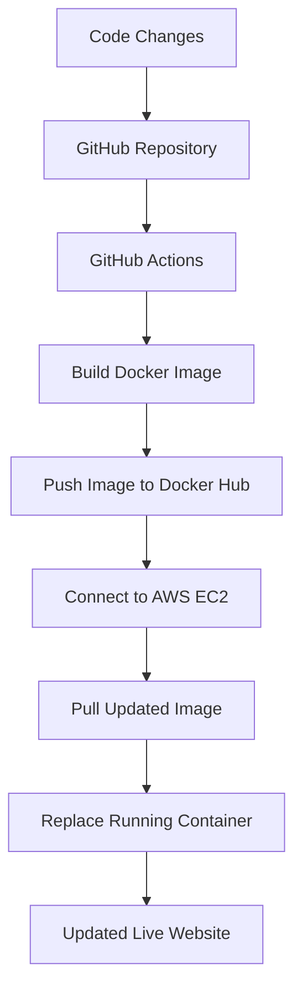

# Velora Jewelry — Automated CI/CD Deployment on AWS EC2

A Dockerized jewelry website deployed on AWS EC2 through an automated CI/CD pipeline using GitHub Actions and Docker Hub.

This project demonstrates how code changes can be automatically built into a Docker image, published to a container registry, and deployed to a cloud-hosted application without manually connecting to the server for each update.

## Project Overview

Velora Jewelry is a web application built to practice containerization, CI/CD automation, and cloud deployment.

The project automates the deployment workflow from a GitHub code push to an updated website running on an AWS EC2 instance.

### Key Features

- **Docker Containerization:** Package the application into a portable Docker image.
- **CI/CD Automation:** Trigger the deployment pipeline when code is pushed to GitHub.
- **Automated Image Publishing:** Build and push updated Docker images to Docker Hub.
- **Cloud Deployment:** Host the containerized application on AWS EC2.
- **Automated Application Updates:** Pull the latest built image and replace the running container.
- **Remote Deployment:** Execute deployment commands on EC2 through GitHub Actions.

## Architecture



## Tech Stack

| Technology | Purpose |
|---|---|
| Git and GitHub | Version control and source code hosting |
| GitHub Actions | CI/CD workflow automation |
| Docker | Application containerization |
| Docker Hub | Container image registry |
| AWS EC2 | Cloud hosting and deployment |
| Ubuntu Linux | Server environment |
| SSH | Secure remote server access |

## CI/CD Workflow

The deployment process is automated using GitHub Actions.

1. **Code Changes:** Modify the website's source code.
2. **Push to GitHub:** Push the changes to the configured repository branch.
3. **Workflow Trigger:** GitHub Actions starts the configured workflow.
4. **Build Docker Image:** Create a new image containing the updated application.
5. **Push to Docker Hub:** Authenticate with Docker Hub and publish the image.
6. **Connect to EC2:** Establish an SSH connection to the cloud server.
7. **Deploy Updated Image:** Pull the new image, stop and remove the previous container, and start the updated container.
8. **Verify Deployment:** Access the hosted website and confirm that the changes are live.

This workflow removes the need to manually SSH into the server and execute deployment commands after every code change.

## Running Locally

### Prerequisites

- Git
- Docker installed and running

### 1. Clone the Repository

```bash
git clone <YOUR_GITHUB_REPOSITORY_URL>
cd <YOUR_REPOSITORY_DIRECTORY>
```

### 2. Build the Docker Image

```bash
docker build -t velora-jewelry:local .
```

### 3. Run the Container

```bash
docker run -d \
  --name velora-jewelry \
  -p 8080:80 \
  velora-jewelry:local
```

Open `http://localhost:8080` in your browser.

The example assumes the application listens on port `80` inside the container. Adjust the port mapping to match your application's configuration.

### 4. Stop and Remove the Container

```bash
docker stop velora-jewelry
docker rm velora-jewelry
```

## Deployment Configuration

The application is deployed to an AWS EC2 instance running Ubuntu with Docker installed.

The deployment setup includes:

- An EC2 instance accessible through SSH.
- Docker installed on the server.
- A Docker Hub repository for storing application images.
- A GitHub Actions workflow for building, publishing, and deploying images.
- GitHub repository secrets for sensitive credentials.

### GitHub Actions Secrets

Configure the secrets and variables required by your workflow under your repository's **Settings → Secrets and variables → Actions**.

Typical configuration values include:

| Name | Purpose |
|---|---|
| `DOCKERHUB_USERNAME` | Docker Hub username |
| `DOCKERHUB_TOKEN` | Docker Hub access token |
| `EC2_HOST` | EC2 public IP address or hostname |
| `EC2_USER` | SSH username |
| `EC2_SSH_KEY` | Private SSH key used for deployment |

These are example names. Use the exact names referenced in your workflow.

**Security:** Never commit private SSH keys, access tokens, or cloud credentials to the repository. Store sensitive values in GitHub Secrets.

## Testing and Verification

The pipeline was tested by modifying the website, pushing the changes to GitHub, and verifying that the workflow built and published the updated Docker image and deployed it to EC2.

The live website was checked to confirm that the updated content was visible.

The resulting deployment flow is:

`GitHub Push → GitHub Actions → Docker Hub → AWS EC2 → Updated Website`

## Key Learnings

This project provided hands-on experience with:

- Docker image creation and container management.
- CI/CD workflow configuration using GitHub Actions.
- Automated Docker image publishing.
- SSH-based remote deployment.
- Deploying containerized applications to AWS EC2.
- Managing deployment credentials securely.
- Troubleshooting Docker registry and deployment issues.
- Understanding the process of delivering code changes to a live application.

## Future Improvements

Potential enhancements include:

- Automated application health checks.
- Rollback to a previous working image after a failed deployment.
- Zero-downtime deployment strategies.
- Infrastructure provisioning using Terraform.
- Application monitoring and alerting.
- Automated testing and container security scanning.

## Author

**Fatima Sarwar**

Computer Science Graduate | Junior Software Engineer transitioning into DevOps

- GitHub: [fatima-dev23](https://github.com/fatima-dev23)
- LinkedIn: [Fatima Sarwar](https://linkedin.com/in/fatima-sarwar)

---

This project was built to gain practical experience in Docker, CI/CD automation, and cloud application deployment.
